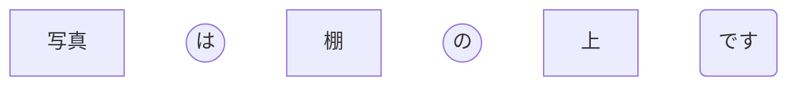
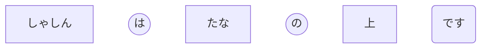
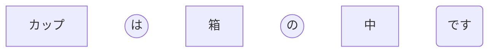
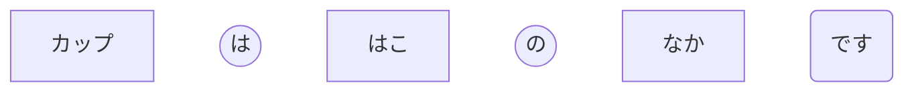

+++
title = 'Positions (位置 / いち)'
date = 2026-11-05T18:29:23+01:00
category = 'vocabulary'
+++

| Schema | Kana | Kanji | Romaji | Translation |
| --- | --- | --- | --- | --- |
|  | なか | 中 | naka | inside |
|  | まえ | 前 | mae | in front |
|  | うしろ | 後ろ | ushiro | behind |
|  | うえ | 上 | ue | above |
|  | した | 下 | shita | below |
|  | よこ | 横 | yoko | beside; to the side |
|  | となり | 隣 | tonari | next to |
|  | ちかく | 近く | chikaku | near |
|  | そと | 外 | soto | outside |

---
# Examples

- The photo(写真) is on the shelf(棚).

---
- The cup(カップ) is in the box(箱).

